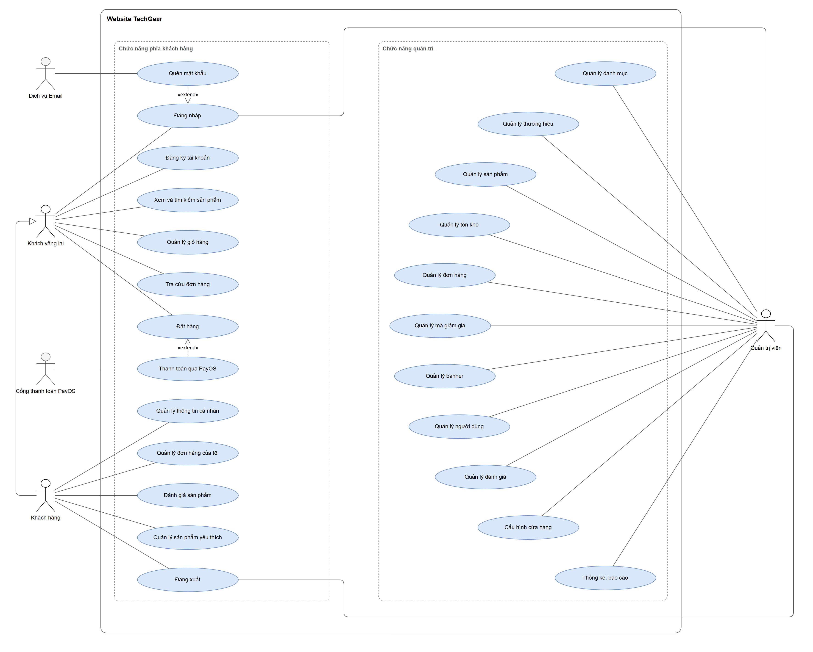
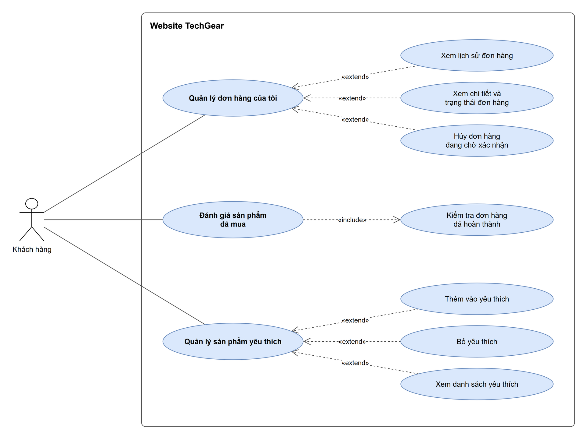
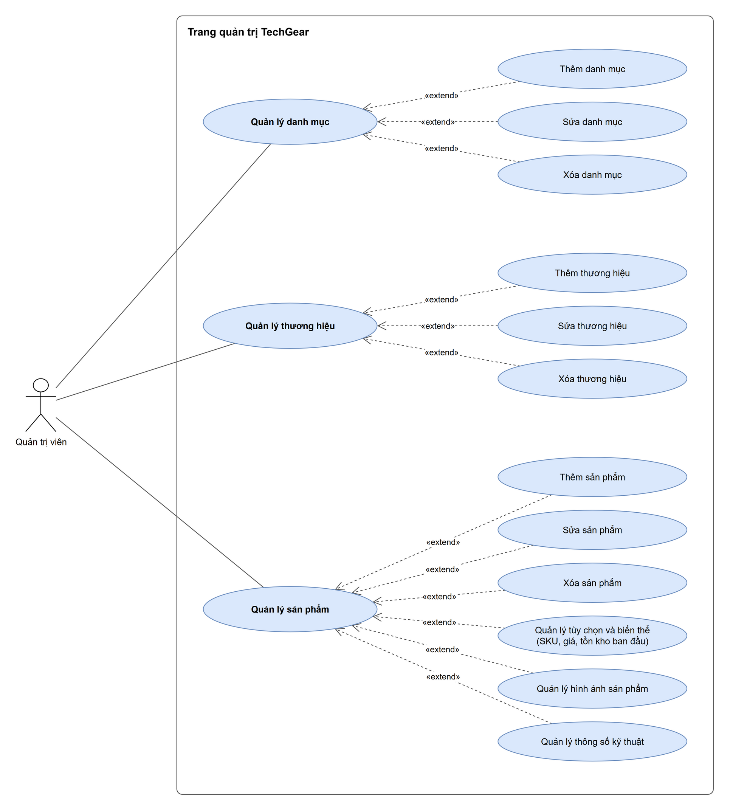
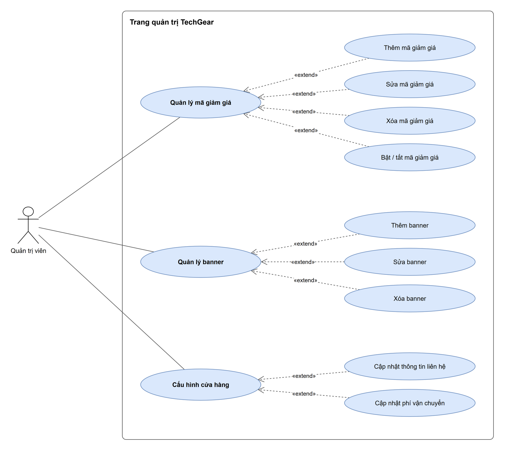

# TechGear – Website thương mại điện tử bán phụ kiện công nghệ

Nhóm sinh viên thực hiện:

- Trần Phú Dinh - 110123007 - DA23TTA
- Khưu Gia Bảo - 110123004 - DA23TTA
- Trần Hoàng Long - 110123025 - DA23TTA

| Thành phần | Công nghệ |
|---|---|
| Frontend | ReactJS 18 + Vite 5, React Router 6, Axios |
| Backend | Java 21, Spring Boot 4.1 (Web MVC, Data JPA, Security + OAuth2 Resource Server/JWT, Validation, Mail), Flyway, springdoc-openapi (Swagger UI) – **đang viết lại** |
| CSDL | PostgreSQL 17 (chạy bằng Docker Compose) – **đang viết lại** |

## Cấu trúc thư mục

```
TechGear/
├── docs/
│   └── so-do-use-case/           9 sơ đồ use case (draw.io)
└── source/
    ├── backend/                  Spring Boot REST API (cổng 8080) – đang viết lại
    └── frontend/                 React (cổng 5173)
        └── src/
            ├── api/              axiosClient (tự gắn token), các hàm gọi API
            ├── components/       Header, Footer, ProductCard, ProtectedRoute...
            ├── context/          AuthContext (đăng nhập), CartContext (giỏ hàng localStorage)
            ├── pages/            Trang chủ, danh sách, chi tiết, giỏ hàng, đăng nhập, đăng ký...
            └── utils/            Định dạng tiền VNĐ, đường dẫn ảnh
```

## Sơ đồ thiết kế

Đang vẽ lại cùng đợt viết lại backend (ERD, kiến trúc, hoạt động, tuần tự, trạng thái) và đặc tả API – sẽ nằm trong `docs/thiet-ke/`.

## Sơ đồ use case

Nằm trong `docs/so-do-use-case/`, vẽ bằng draw.io (`.drawio`, `.drawio.png`, `.svg`). Tác nhân và quy ước quan hệ: xem [`docs/so-do-use-case/README.md`](docs/so-do-use-case/README.md).

### Use case tổng quát

[](docs/so-do-use-case/01_use_case_tong_quat.drawio.png)

### Phía khách hàng

| Xem, tìm kiếm sản phẩm | Giỏ hàng, đặt hàng, thanh toán |
|:---:|:---:|
| [](docs/so-do-use-case/02_uc_xem_tim_kiem_san_pham.drawio.png) | [](docs/so-do-use-case/03_uc_gio_hang_dat_hang.drawio.png) |
| **Tài khoản** | **Đơn hàng, đánh giá, yêu thích** |
| [](docs/so-do-use-case/04_uc_tai_khoan.drawio.png) | [](docs/so-do-use-case/05_uc_don_hang_danh_gia.drawio.png) |

### Phía quản trị

| Danh mục, thương hiệu, sản phẩm | Tồn kho, đơn hàng |
|:---:|:---:|
| [](docs/so-do-use-case/06_uc_qt_san_pham.drawio.png) | [](docs/so-do-use-case/07_uc_qt_kho_don_hang.drawio.png) |
| **Mã giảm giá, banner, cấu hình** | **Người dùng, đánh giá, thống kê** |
| [](docs/so-do-use-case/08_uc_qt_khuyen_mai_giao_dien.drawio.png) | [](docs/so-do-use-case/09_uc_qt_nguoi_dung_thong_ke.drawio.png) |

## Cách chạy

### Yêu cầu

| Công cụ | Phiên bản | Ghi chú |
|---|---|---|
| JDK | 21 | VD: Eclipse Temurin 21 |
| Maven | 3.9+ | IntelliJ IDEA có sẵn Maven |
| Node.js | 18 trở lên | |
| Docker Desktop | mới nhất | Chạy PostgreSQL 17 bằng Docker Compose |

### 1. Cơ sở dữ liệu và 2. Backend

Đang viết lại (PostgreSQL + Spring Boot 4) – hướng dẫn chạy, tài khoản mẫu và cách kiểm thử bằng Postman sẽ được cập nhật khi xong.

### 3. Frontend

```bash
cd source/frontend
npm install
cp .env.example .env
npm run dev
```
Mở `http://localhost:5173`. Địa chỉ backend cấu hình trong file `.env` (`VITE_API_URL`).

## Danh sách API

Đang viết lại. Backend mới giữ nguyên các API mà frontend hiện đang gọi (`/api/auth/dang-ky`, `/api/auth/dang-nhap`,
`/api/auth/toi`, `/api/danh-muc`, `/api/thuong-hieu`, `/api/san-pham`, `/api/san-pham/noi-bat`, `/api/san-pham/{slug}`).
Đặc tả đầy đủ sẽ nằm ở `docs/thiet-ke/dac-ta-api.md`.

## Tiến độ viết lại backend

| Giai đoạn | Nội dung | Trạng thái |
|---|---|---|
| 0. Dọn sạch | Xóa backend, script CSDL MySQL và tài liệu thiết kế cũ | Xong |
| 1. Thiết kế | Đặc tả yêu cầu, ERD PostgreSQL, kiến trúc, danh sách API | Chưa |
| 2. Nền tảng | Spring Boot 4, Docker Compose, Flyway, bảo mật JWT, xử lý lỗi, Swagger, upload | Chưa |
| 3. Tài khoản | Đăng ký, đăng nhập, hồ sơ, mật khẩu, sổ địa chỉ | Chưa |
| 4. Sản phẩm | Danh mục, thương hiệu, tìm kiếm/lọc, chi tiết, banner, cài đặt | Chưa |
| 5. Giỏ hàng | Giỏ hàng trên server, gộp giỏ, yêu thích | Chưa |
| 6. Đặt hàng | Mã giảm giá, phí vận chuyển, tồn kho, đơn hàng, hủy, tra cứu | Chưa |
| 7. Thanh toán | VNPay (sandbox) | Chưa |
| 8. Đánh giá | Đánh giá sản phẩm đã mua, chờ duyệt | Chưa |
| 9. Quản trị | Sản phẩm, kho, đơn hàng, khuyến mãi, người dùng, thống kê | Chưa |
| 10. Dữ liệu mẫu | Dữ liệu mẫu đầy đủ + file `database/DB_TechGear.sql` | Chưa |
| 11. Bàn giao | Kiểm thử toàn bộ, tài liệu, review | Chưa |
